# Mendlet

**Point your phone at something broken. Mendlet outlines the damage on your own photo, tells you honestly whether it's worth fixing, and walks you through the repair step by step, with the stitches drawn right onto your item.**

> Meta Global AI Developer Hackathon 2026 · Indie track · Theme: *Build for Your World*

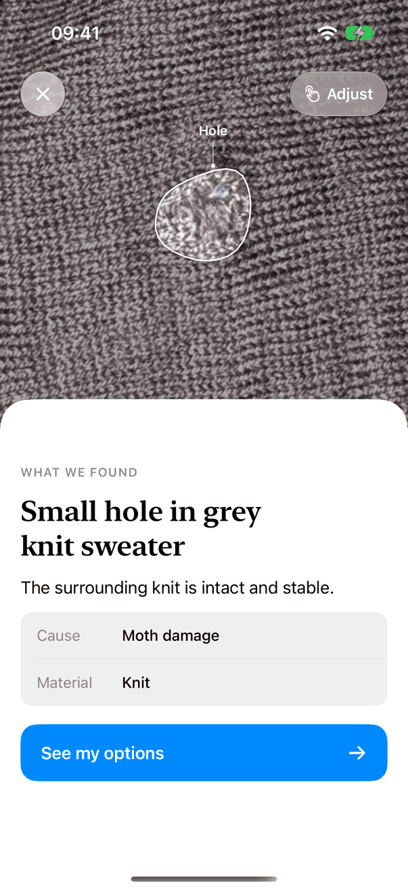

## Why I built this

I kept throwing away clothes that had one small hole. Not because I couldn't sew a few stitches, but because I never knew *where to start*: what exactly is broken, is it even worth it, what do I need, and how does the needle actually go?

That's a common story. Every person in the EU throws away about **16 kg of textiles a year** (EEA, 2022), and worldwide a garbage truck of clothing is landfilled or burned **every second** (Ellen MacArthur Foundation). Wearing a garment nine months longer cuts its footprint by up to 20 % (WRAP). Sources and how I checked them: [`docs/impact.md`](docs/impact.md).

Mendlet answers the "where do I start" part, on the item itself.

## What it does

1. **Scan.** Take a photo of the damage, or pick one from your library.
2. **See it outlined.** The hole, tear or loose sole is traced pixel by pixel on your photo. Small damage gets zoomed in automatically. If the outline is off, you tap the right spot and it's re-traced.
3. **Get an honest verdict.** *Repair it yourself*, *Take it to a pro* or *Replace it*, with time, effort and a cost estimate. "Replace" comes with ideas for a second life (cleaning rags, textile recycling). If the thing is dangerous to repair at home, like a cracked bike helmet or anything with a lithium battery, you get no instructions at all.
4. **See it repaired first.** One tap shows *your own* item mended, before you've threaded a needle.
5. **Gather what you need.** A short checklist: needle, yarn, scissors, with a shop search for anything missing.
6. **Repair, step by step.** A full-screen photo guide. Stitch rows draw themselves over the hole, the glue zone fills along the sole, the solder route runs from wire to pad. Some steps also show a generated photo of what it should look like at that point. Stuck? Say what's wrong ("the yarn pulls the knit together") and get an answer for exactly this step.
7. **Come back later.** Unfinished repairs wait on the home screen as projects, with what you still need and where you left off. Glue curing and solder timers run as a Live Activity on the Lock Screen.

| Repairs | Outlined damage | Verdict | Before you start | Step guide |
| --- | --- | --- | --- | --- |
| 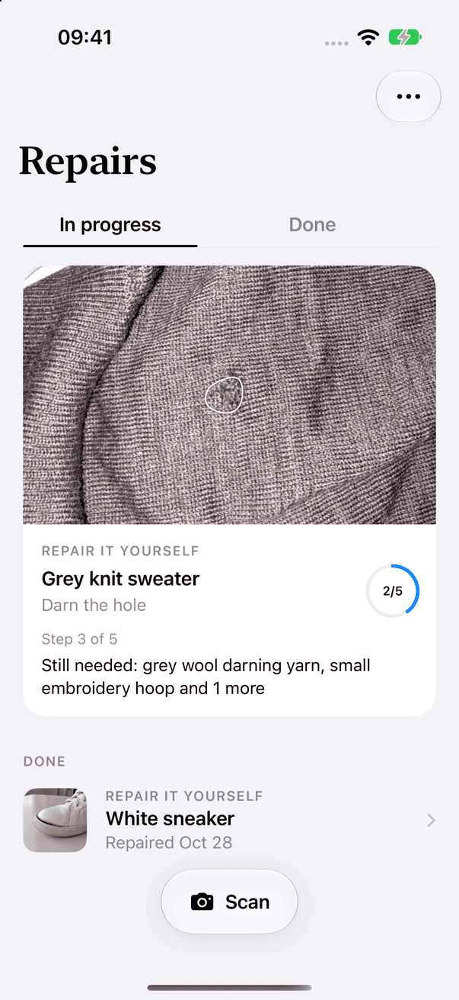 | 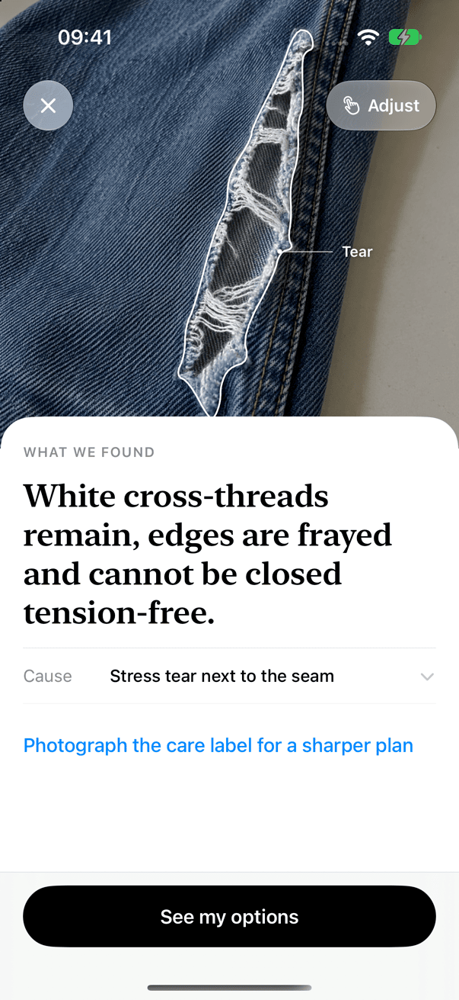 | 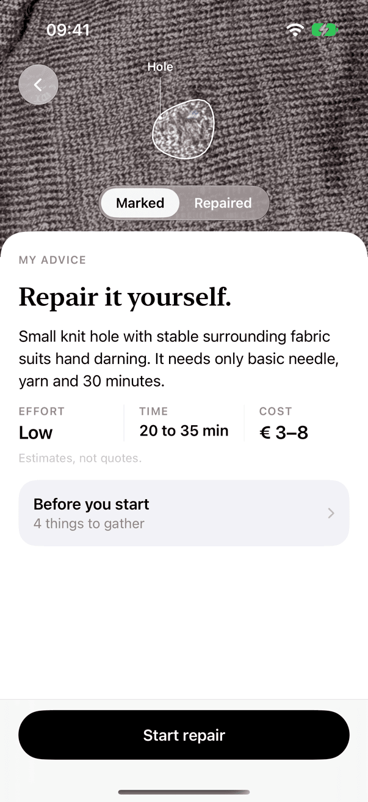 | 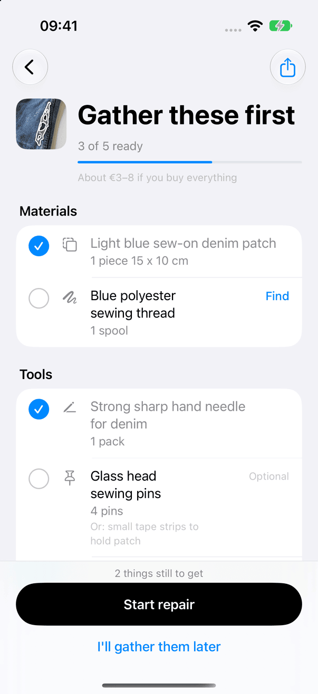 | 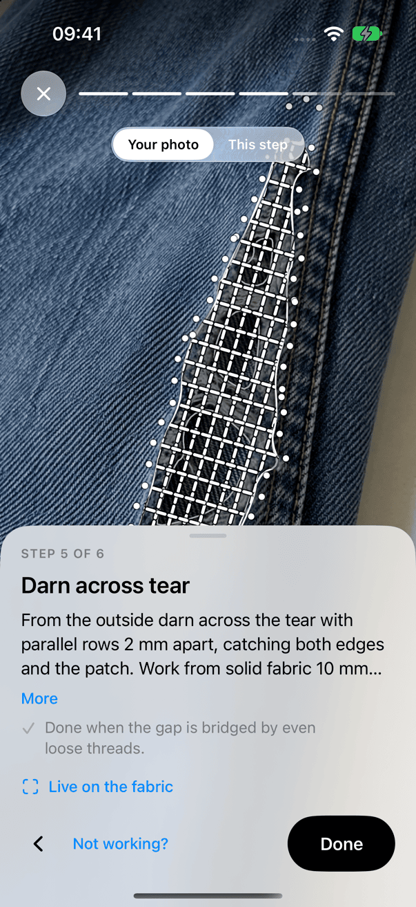 |
| **Leather sole → cobbler** | **Worn-out shirt → replace** | **Glue zone** | **Wire to the + pad** | **Battery → blocked** |
| 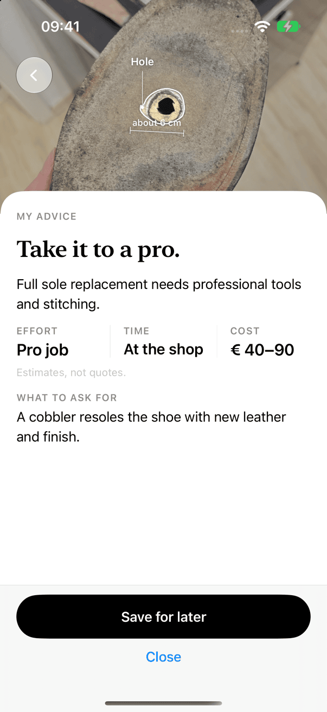 | 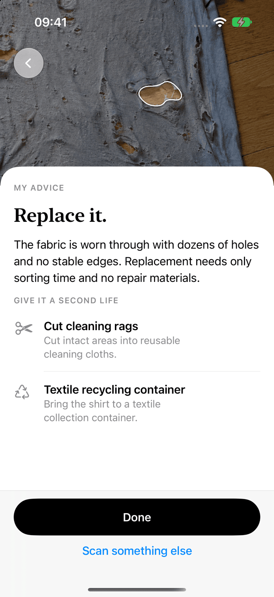 | 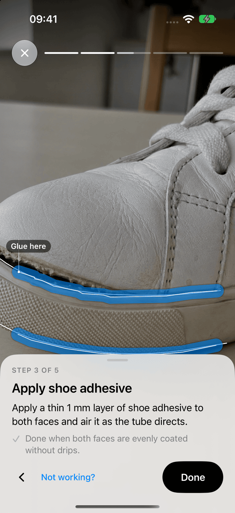 | 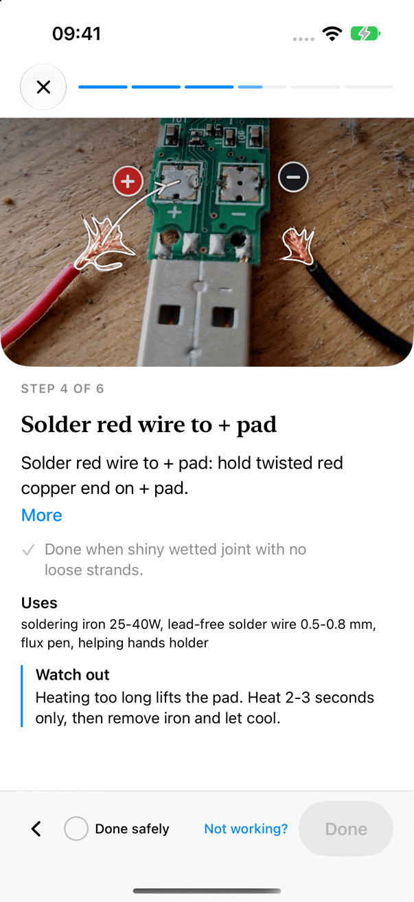 | 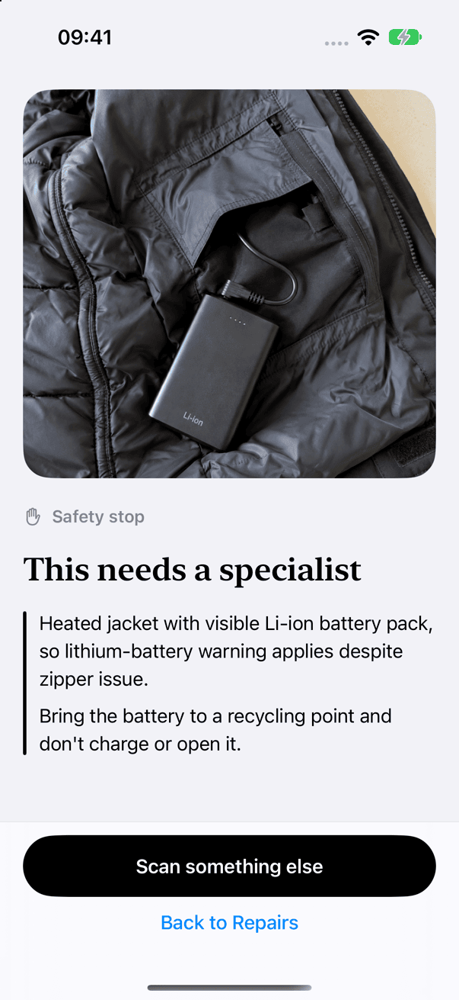 |

## How I use Meta's models

Five Meta models, each with one clear job. The interesting part is how they hand work to each other.

### SAM 3.1: the outline

SAM draws every mask you see: the damage, the parts around it, wires and solder pads. It is used three ways: with text concepts ("sole", "garment"), with a box from Muse Spark, and with tap points when you correct an outline.

**What I learned:** SAM can't find damage by name. On a jeans leg with an obvious tear, the concept "tear" returned *zero* masks. That makes sense once you think about it: a tear or a hole isn't an object, it's missing fabric. So I stopped asking SAM to *find* damage and started telling it *where* to look (see Muse Spark below). With a box, the same tear came back at score 0.94.

A second lesson came from a real photo of a worn-out leather sole. SAM's text prompt marked the whole sole as "detached sole" while Spark's box sat exactly on the hole. When a much smaller grounded box lies inside a broad SAM mask, the precise one wins now (`proxy/app/pipeline.py`, with a regression test).

### Muse Spark: the brain

Spark does most of the thinking, in four separate calls:

- **Safety and category first.** Before anything else, Spark classifies the item and its risk. Blocked categories never reach the planning step.
- **Pointing at the damage.** Spark's perception grounding returns a box on a 0–1000 grid around the hole or tear. That box becomes SAM's prompt. This Spark → SAM hand-off is what makes small holes findable. It also reads the + and − on a circuit board's silkscreen, so the app knows which pad the red wire goes to.
- **Diagnosis and plan.** Spark writes the finding, the verdict, the shopping list and the steps as JSON against a strict schema. The proxy validates every answer and retries once on invalid JSON.
- **Help during a step.** "Not working?" sends the current step and your question to Spark.

The prompts live in [`prompts/`](prompts/). The current diagnosis prompt asks for plain, confident language: no "presumably", short imperative step titles, and every step ends with a "Done when …" line so you know when to move on.

### Muse Image: seeing the result first

Muse Image edits *your own photo* into the repaired state for the before/after toggle, and generates a photo for some guide steps showing the item mid-repair. The prompt insists on a barely visible mend in matching yarn. Early previews showed thick contrasting thread in an X shape, which nobody would want on their sweater.

### Muse Wonder: precision mode

Optional, switchable in Settings. Instead of the fixed pipeline, a Wonder agent runs a tool loop: it decides what to segment, asks Spark to locate damage, has SAM cut it out, and then **checks its own masks** with Spark before writing the plan. In my benchmark it put 10 of 10 masks on real damage with zero false positives (the classic path had extra marks in 3 cases). It once recovered on its own from a SAM server error by switching to a Spark box. The trade-off is time: about 60–90 s instead of about 25 s, which is why it isn't the default. Settings → *How Mendlet works* shows the real trace of the last analysis.

### Muse Voice Transcribe: talking while your hands are busy

When you're holding a needle you don't want to type. Voice transcribes the damage note, follow-up answers and questions during a step. It is biased towards repair vocabulary such as *darning*, *hem*, *patch* and *solder pad*, so those words come through correctly.

## How it's built

```
 iPhone app (SwiftUI)                       Proxy (Python, FastAPI)                    Meta Model API
┌───────────────────────────┐   HTTPS/SSE  ┌──────────────────────────────────┐       ┌───────────────┐
│ Scan · Analysis · Verdict │ ───────────▶ │ 1 safety + category  ─ Spark     │ ────▶ │ Muse Spark    │
│ Checklist · Photo guide   │ ◀─────────── │ 2 masks  ─ SAM text ∥ Spark box  │       │ SAM 3.1       │
│ Projects · Live Activity  │  progress,   │      → SAM box (merge, dedupe)   │       │ Muse Image    │
│                           │  masks, plan │ 3 diagnosis + plan ─ Spark (JSON)│       │ Muse Wonder   │
│ Stitch / glue / solder    │              │ 4 safety enforcement (rules)     │       │ Muse Voice    │
│ geometry from the masks   │              │ budget cap · cache · mock mode   │       └───────────────┘
└───────────────────────────┘              └──────────────────────────────────┘
```

**Why a proxy?** The API key must never ship inside an app, where anyone could pull it out of the binary. The proxy holds the key and runs the multi-step pipeline in one tested place. Safety rules are enforced on the server where they can't be bypassed. A daily spend cap and a disk cache keep costs predictable, and a mock mode makes everything testable without a key.

**The pipeline** (`proxy/app/pipeline.py`) streams its progress to the app as server-sent events, so the outline appears while the plan is still being written:

1. Spark classifies item and risk. Batteries, mains power and helmets stop here.
2. SAM text concepts and Spark grounding run **in parallel**. Spark's box goes to SAM as a box prompt. The results are merged: duplicates removed, the precise box beats a broad one, and uncertain SAM hits far from where Spark sees damage are dropped.
3. Spark writes diagnosis, verdict, checklist and steps, validated against a Pydantic schema.
4. A deterministic safety pass (`proxy/app/safety.py`) enforces the rules no matter what the model said: no guide for blocked items, "second life" ideas only on replace, at most one follow-up question round.

**The geometry is mine, not the model's.** No model outputs stitch coordinates. The app computes the darning grid, ladder stitch, glue band and wire-to-pad route from SAM's mask (`ios/RepairAssistant/Rendering/StitchPathPlanner.swift`), clipped to the damage and anchored in intact fabric. That keeps the overlay exactly on your item and makes it testable.

**The app** (`ios/`) is SwiftUI on iOS 17+, built from `project.yml` with XcodeGen:

| Folder | What's in it |
| --- | --- |
| `Views/` | Home, scan, analysis, finding, verdict, checklist, guide, project, settings |
| `Flow/` | `FlowModel`, the app's state machine, plus settings, demo bootstrap and display text polish |
| `Models/` | The API contract (`Contract.swift`) and navigation gates (`Gates.swift`) |
| `Rendering/` | Masks, labels, stitch-path planner and the stitch, glue and solder overlays |
| `Services/` | API client, mock client with recorded responses, audio, project store, Live Activity |
| `Live/` | Live camera scanning |
| `RepairWidgets/` | Lock Screen and Dynamic Island Live Activity |

## Safety

Mendlet only gives instructions where a mistake stays harmless. Lithium batteries (including heated clothing), mains-powered devices, helmets and child seats are blocked **before** any diagnosis. Electronics are only handled without battery or mains power, and those guides always start with disconnecting power and a continuity test. Costs and times are labelled as estimates. Rules: `proxy/app/safety.py`, tests: `proxy/tests/test_safety.py`.

## Try it

### Without a key: demo mode (recommended for judges)

The app starts in demo mode. It replays **real, unedited Meta API responses** I recorded during the hackathon (`ios/RepairAssistant/Resources/LiveRecordings/`), so it runs on the iOS Simulator with no key and no server.

```bash
# Xcode 27 + XcodeGen (brew install xcodegen)
./scripts/run-demo.sh
```

Or open `ios/RepairAssistant.xcodeproj` in Xcode, choose the `RepairAssistant` scheme and run it on any iPhone simulator.

### With a key: the live pipeline

```bash
cd proxy
uv sync
cp .env.example .env          # put your Meta Model API key into META_API_KEY
uv run uvicorn app.main:app --host 0.0.0.0 --port 8787
```

Every setting is explained in [`proxy/.env.example`](proxy/.env.example). Leave `META_API_KEY` empty and the proxy runs in mock mode. `AGENT_MODE=wonder` makes Muse Wonder the default, and `DAILY_BUDGET_USD` caps spending per day.

To point the app at your proxy, copy `ios/Config.example.xcconfig` to `ios/Config.local.xcconfig` and set `PROXY_BASE_URL` to `http://<your-mac's-LAN-IP>:8787`. In the app, open Settings, tap *Version* five times and switch on **Use server**.

## Tests and quality

```bash
# Proxy: 257 tests, fully offline (real network calls are blocked in tests)
cd proxy && uv run pytest -q
uv run ruff check . && uv run ruff format --check .

# App: unit tests on the simulator
xcodebuild test -project ios/RepairAssistant.xcodeproj -scheme RepairAssistant \
  -destination 'platform=iOS Simulator,name=iPhone 17 Pro'

# Screenshots of every screen in demo mode
./scripts/screenshots.sh
```

The proxy tests check the exact requests sent to the Meta API, SSE parsing, the SAM mask decoder, caching, the budget cap, the safety rules and the full pipeline. The app tests cover the contract decoding, navigation gates, the stitch-path geometry (every stitch stays inside the damage), the display text polish and the recordings.

**Benchmark.** 18 cases, including two real phone photos, run against the live API: [`docs/benchmark.md`](docs/benchmark.md). It also lists what went wrong and how it was fixed. `proxy/scripts/run_benchmark.py` reruns it, and `overlay_contact_sheet.py` draws every mask onto its photo for a quick visual check.

## Project layout

```
ios/          SwiftUI app, Live Activity widget, unit tests (XcodeGen project.yml)
proxy/        FastAPI proxy, pipeline, safety rules, tests, benchmark scripts
prompts/      Versioned prompts for classification, diagnosis and step help
testdata/     Benchmark photos and cases (see SOURCES.md)
docs/         Benchmark, impact sources, API notes, screenshots
scripts/      run-demo.sh, screenshots.sh
```

## Built during the hackathon

The first commit was made three hours after the kickoff on 26 October 2026. Everything in this repository was built during the hackathon, and `git log` shows every commit with its timestamp.

## Assets and credits

- Icons are SF Symbols. Fonts are Apple's system fonts.
- The sweater and the leather sole are real phone photos. The other test photos in `testdata/` are **AI-generated** and labelled per file in [`testdata/SOURCES.md`](testdata/SOURCES.md).
- The animated orb is a SwiftUI port of [thinking-orbs](https://github.com/Jakubantalik/thinking-orbs) by Jakub Antalik (MIT). See [`THIRD_PARTY_NOTICES.md`](THIRD_PARTY_NOTICES.md).

## License

MIT, see [`LICENSE`](LICENSE).
