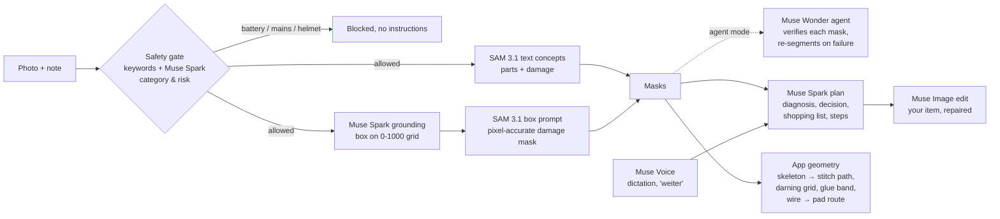

# Repair Assistant: fix it on your own photo

Point your phone at a torn shirt, a split seam, a sneaker whose sole is coming off or a USB lamp with a broken wire. The app marks the damage pixel-accurately on **your** photo, tells you honestly whether to repair it yourself, go to a pro or replace it, shows your own item repaired before you start, builds a shopping list and guides you step by step. On textiles it draws the stitch path along the real tear, on shoes the glue zone, on electronics which wire goes to which pad.

> Meta Global AI Developer Hackathon 2026 · Indie track · Theme: **Build for Your World**

**Why it matters:** Every second, one garbage truck of clothing is landfilled or burned worldwide (Ellen MacArthur Foundation). Every person in the EU throws away about 16 kg of textiles a year (EEA, 2022). Wearing clothes nine months longer cuts their footprint by up to 20 % (WRAP). Many of those items fail at one tear that could be fixed in 20 minutes. Sources and verification status: [`docs/impact.md`](docs/impact.md).

## Not an image analyzer: what happens between photo and plan



The key finding from our live tests: **SAM 3.1 cannot find a tear by name** ("tear" = 0 matches on an obvious tear), because a tear is a gap, not an object. Muse Spark locates the damage on its perception-grounding grid and hands SAM a box, and SAM returns a pixel-accurate mask (score 0.94). The app then computes the stitch path from that mask with its own geometry; no model outputs coordinates for stitches. Details: [`docs/benchmark.md`](docs/benchmark.md).

## How Meta's models are used

| Model | Job in the app | Measured live |
| --- | --- | --- |
| **SAM 3.1** (`sam-3.1`) | Masks for damage, parts, wires and solder pads; text concepts, box prompts from Spark, tap-to-refine points, video tracking (`/track`) | Tear 0.94 via Spark box, 3 sweater holes as separate instances, wires 0.88/0.95 |
| **Muse Spark** (`muse-spark-1.3`) | Safety and category check; perception grounding for damage and solder pads (reads the +/− silkscreen); diagnosis, decision, shopping list and steps as schema-validated JSON; reads care labels | Plan in ~13–16 s at `reasoning_effort=low` |
| **Muse Image** (`muse-image-1.0`) | Edits your own photo into the repaired state for the before/after slider | Jeans and sweater, 11–12 s |
| **Muse Wonder** (`muse-wonder-1.0`) | Optional agent mode: plans the search, verifies every damage mask with Spark, re-segments with box/points on failure | Recovered from a live SAM HTTP 500 via Spark locate → SAM box |
| **Muse Voice Transcribe** (`muse-voice-transcribe-1.0`) | Dictation and hands-free step control ("weiter") with keyword biasing for repair vocabulary | Error-free German transcript, 2.9 s |

Open-weight models (Muse Glimmer, Muse Spark Open) are not used.

## Built during the hackathon

The hackathon started with the kickoff on **2026-10-26, 12:00 PM ET**. The first commit of this project is **2026-10-26 20:03 CET = 15:03 ET**, three hours after kickoff. No code, assets or data from earlier projects are used. This repository contains only this project.

| Date (ET) | What was built |
| --- | --- |
| Oct 26, 15:03–15:24 ET (after the 12:00 kickoff) | PRD and API notes from the Meta docs; FastAPI proxy in mock mode with safety gate; first SwiftUI app with demo fixtures and stitch-path geometry |
| Oct 28 | First real Meta API calls; Spark grounding → SAM box pipeline; mask overlays with scan reveal; live-scan module; `/refine`, `/track`, `/after-preview`; prompt B v3; latency 46 → 30 s; real recordings for demo mode |
| Oct 29 | Wonder agent mode with live trace; `/detect`; electronics case with solder pads and polarity; Voice keyword biasing; before/after slider; shoe glue overlay; full benchmark |

`git log --date=iso` shows every commit with its timestamp (the history was carried over unchanged when this project moved into its own repository).

## Try it (no server needed)

The app starts in **demo mode**: it replays **real, unedited Meta API responses** recorded on Oct 28–29 (`ios/RepairAssistant/Resources/LiveRecordings/`), so judges can run it on the iOS Simulator without a key or proxy. Scenarios: jeans tear (with optional care-label round), sweater with three holes, sneaker sole, heated jacket with battery (blocked), USB board with broken wires. Settings → "Schnell" shortens the replay for video takes; the agent trace can replay the run where Wonder recovered from a server error.

```zsh
# One command (Xcode 27 + XcodeGen): build and start the app in demo mode on the iPhone simulator
./scripts/run-demo.sh               # or: ./scripts/run-demo.sh jeans_guide  (straight to the stitch path)

# Or in Xcode: open ios/RepairAssistant.xcodeproj, scheme RepairAssistant, run on any iPhone simulator.

# Live pipeline: proxy with your own Meta Model API key
cd proxy && uv sync && uv run pytest -q          # offline tests
cp .env.example .env                              # set META_API_KEY
uv run uvicorn app.main:app --host 0.0.0.0 --port 8787
# optional: AGENT_MODE=wonder for the Muse Wonder agent
# iOS: Settings → demo mode off, proxy URL = http://<your-mac>:8787
```

The key stays on the proxy and is never shipped in the app or committed. Standard mode only (no Contributor models). Daily budget cap in the proxy.

## Safety

The app only gives instructions where a mistake stays harmless. Lithium batteries (also in heated clothing), mains-powered devices, helmets and child seats are blocked **before** any diagnosis. Electronics only without battery and mains, always starting with "disconnect power" and a continuity test. Steps with scissors, heat, glue or soldering need an explicit confirmation. Costs and times are labelled as estimates. Rules: `proxy/app/safety.py`, tests: `proxy/tests/test_safety.py`.

## Assets and tools

All icons are SF Symbols. Test photos in `testdata/` are **AI-generated** and labelled per file in `testdata/SOURCES.md`: most with OpenAI Codex image generation, the electronics and two safety photos with Meta Muse Image. The demo video is filmed by the author with a real garment and a real iPhone. Design references from Mobbin were used for inspiration only (`docs/design-notes.md`). Code was written with AI coding assistants (Claude Code, OpenAI Codex); all components are owned by the author.

## License

MIT, see [`LICENSE`](LICENSE).
